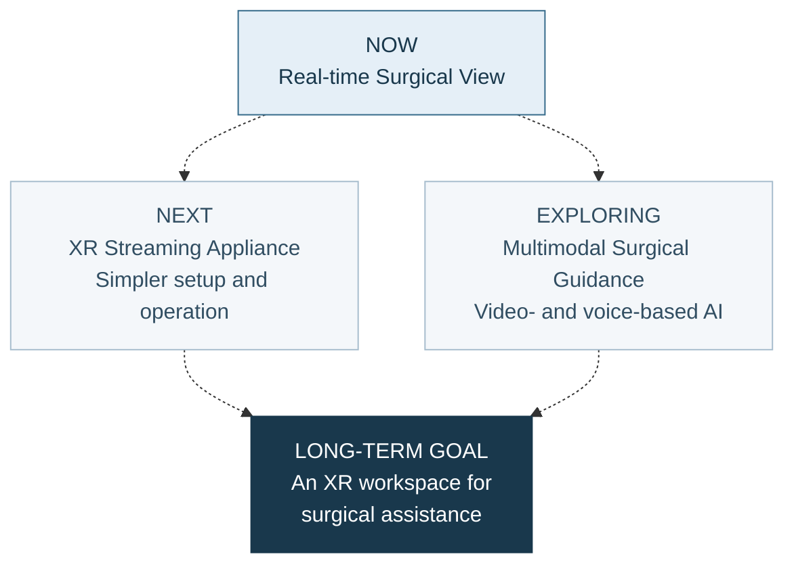

# Surgical XR

**Surgical video and data, in one view.**

Surgical XR is a research project by **MIDAS Lab** exploring how head-mounted displays (HMDs), including **Samsung Galaxy XR** and **Apple Vision Pro**, can support the surgical workflow.

Our goal is an XR workspace that brings surgical video, patient information and **AI-assisted guidance** together. These pages follow the work toward that goal: our prototypes, operating-room tests and what we learn along the way.

[Explore Surgical XR](https://midas-surgai-lab.github.io/surgical-xr/) · [History](https://midas-surgai-lab.github.io/surgical-xr/en/history.html) · [Roadmap](https://midas-surgai-lab.github.io/surgical-xr/en/roadmap.html)

## Where we are heading

The current prototype brings together endoscopic video, CT/MRI, 3D anatomy models and vital signs. Live endoscopic streaming and vital-sign display have been tested in the operating room.

The next hardware step is a dedicated device for capture, encoding and streaming. In parallel, we are exploring how AI could use surgical video and voice to support a specific task. Intended use and evaluation will be considered as each direction takes shape.

---

[MIDAS Lab](https://github.com/MIDAS-SurgAI-Lab)
